# 操作手册

> 适用版本：当前工作区。截图由 `frontend/scripts/capture-help-shots.mjs` 在演示企业真实拍摄，页面改版后需重拍。
> 系统内同名页面：`/help`。

## 01 登录与找回入口

1. 打开系统地址，输入企业注册码、账号、密码。
   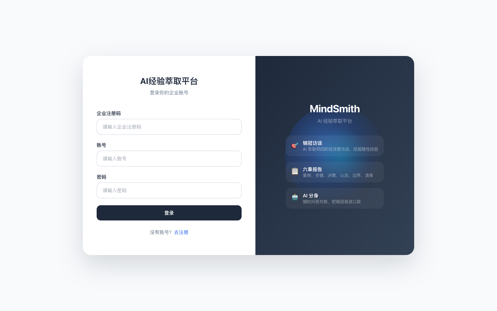
2. 登录后默认进入「运营总览」。顶栏按业务域切换（日常 / 销售 / 分身生产 / 知识 / 管理），左侧栏只显示当前域的入口。
3. 看不到某个菜单，说明当前账号没有对应权限，找企业管理员开通。

**注意**：当前没有自助找回密码，密码由管理员在用户管理中重置。

## 02 上传素材

1. 顶栏「分身生产」→「素材管理」→「上传素材」，选择领域和上传给谁。员工账号可直接在「日常」点「上传素材」。
   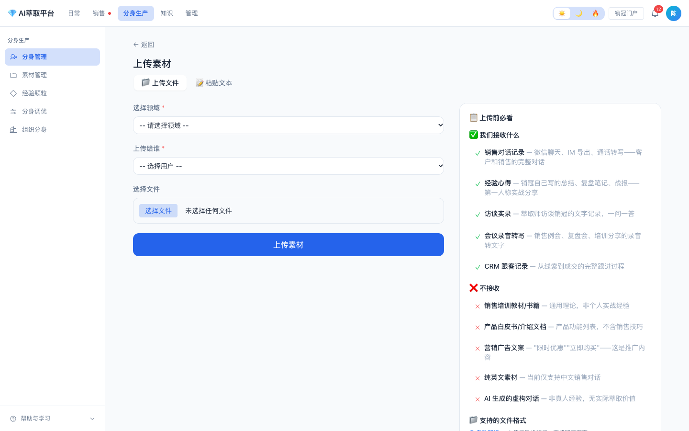
2. 选择文件，或切到「粘贴文本」直接输入。一次最多 5 个文件。
3. 回到素材列表，状态会从「已上传」走到「已萃取」。

**支持格式**

- 文档：`txt`、`md`、`csv`、`html`、`htm`、`pdf`、`docx`、`pptx`
- 图片：`png`、`jpg`、`jpeg`；音频：`mp3`、`wav`（需补录文字）
- 单个文件 ≤ 50MB，单次上传总量 ≤ 50MB
- 中文占比 ≥ 70%，有效内容 ≥ 50 字，与已有素材相似度 > 90% 会被判重复

**不支持**：`.doc`、`.xls`、`.xlsx`、`.ppt`。请先另存为 `.docx`/`.pptx`，或导出为 `txt`/`csv`。

## 03 发起销冠访谈

1. 进入「销冠访谈」，填写主题、选择分身。
   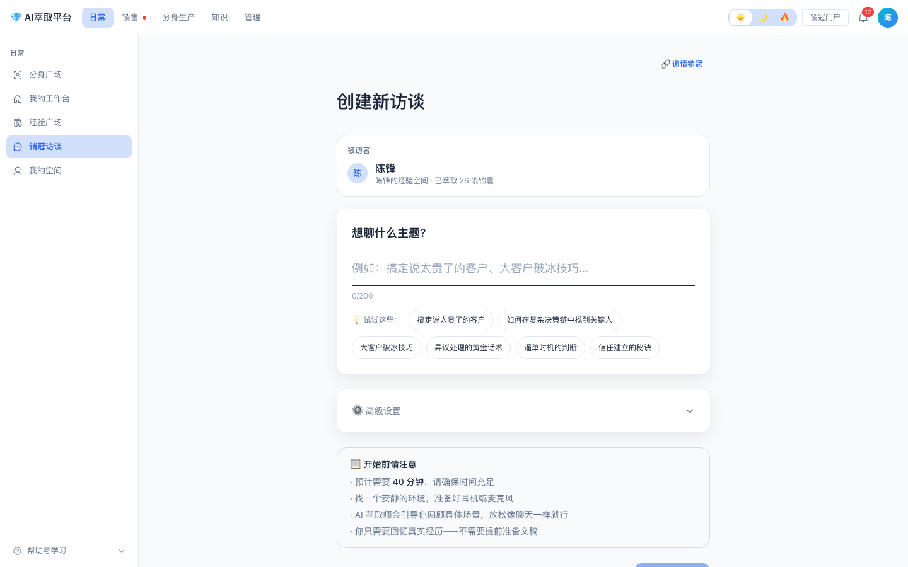
2. 创建后把二维码或链接发给销冠，用手机即可开始。
3. 访谈结束生成六章报告：案例、步骤、决策、心法、边界、清单。

报告里的判断应能对回访谈原话；对不上的会被标成推断。

## 04 看素材处理进度

1. 进入分身详情的「素材」列表，状态列显示当前进度。
   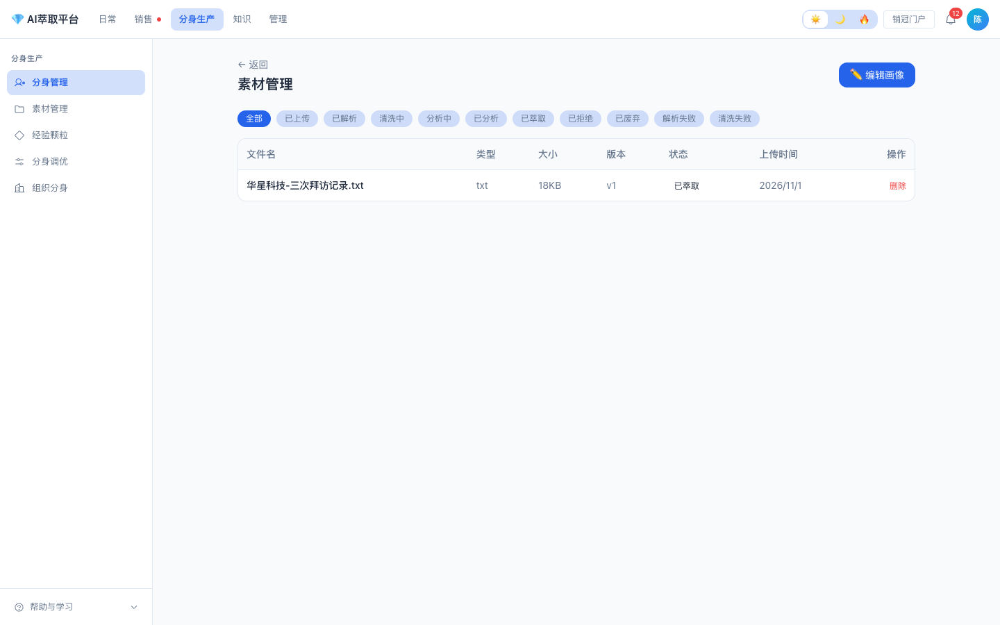
2. 解析/清洗失败会自动重试；第 3 次仍失败才标记为已拒绝。
3. 图片/音频停在「已上传」并提示需人工补充，点「补录文字」粘贴文本后继续。

状态顺序：已上传 → 清洗中 → 分析中 → 已分析 → 已萃取。内容预检或重复检测不通过会直接判已拒绝，不重试。

## 05 审核与发布

1. 从「运营总览 → 待处理」或顶栏「分身生产 → 分身管理」进入审核页。
   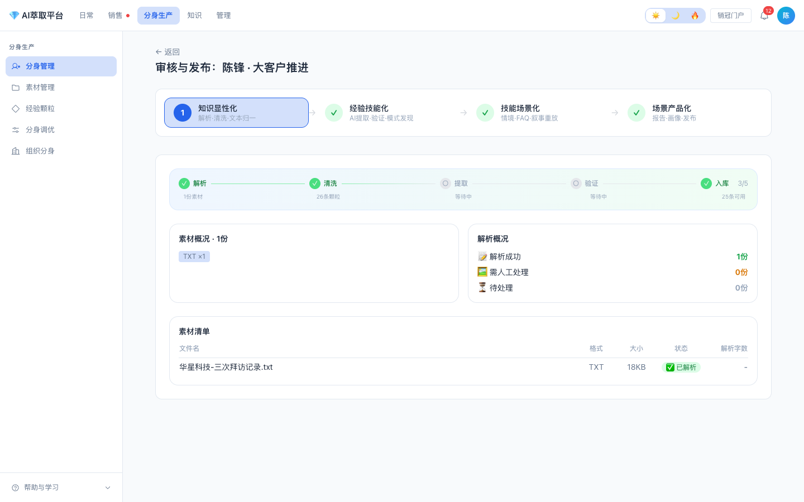
2. 依次检查四步：知识显性化、经验技能化、技能场景化、场景产品化。
3. 补全画像后，确认三道门槛都满足，再点「发布分身」。

**发布门槛**

- 活跃颗粒 ≥ 10
- 场景覆盖 ≥ 3（只算生效中的颗粒）
- 画像姓名、性格、背景、擅长领域齐全

发布后开场白、推荐问题、对练开场白在后台异步生成；已发布的分身可以撤销发布。

## 06 使用分身

1. 从「分身广场」选择已发布的分身，进入对话页。
   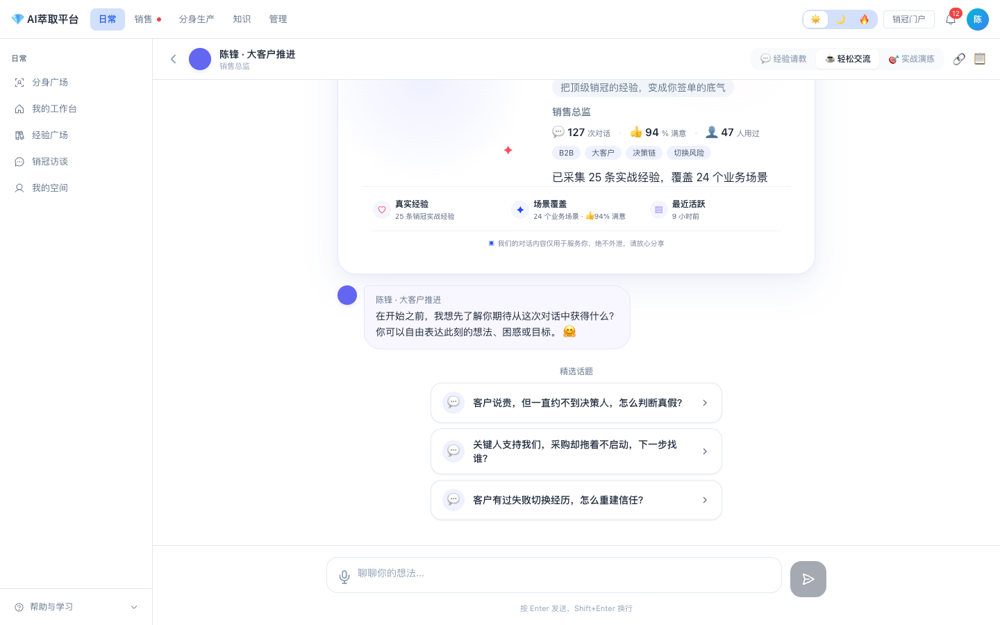
2. 按需要切换「经验请教 / 轻松交流 / 实战演练」。
3. 有依据的回答下方会出现「溯源 · N 条」，点开可看颗粒原文。

溯源需要经验颗粒权限；普通员工看不到入口或会提示无权访问。没有命中颗粒时不会显示溯源。

## 07 销售复盘

1. 进入「销售复盘」→「新建复盘」，粘贴客户沟通原文。
   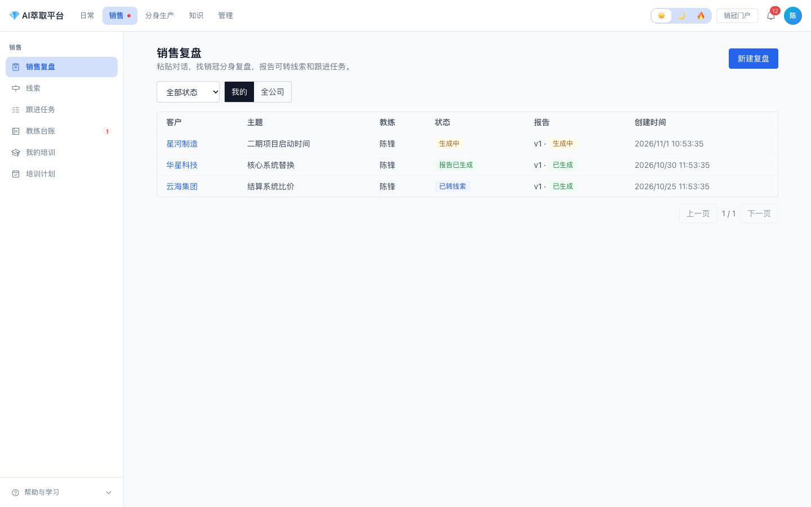
2. 报告生成后查看六个区块：一句话结论、做得好的、不足、风险、客户信号、下一步。
3. 做得好的/不足/风险可点「查看引用」对照原文。

只有最新版且状态为 ready 的报告可以转线索/生成任务；已转过线索的不再显示转线索；历史版本只读。

## 08 处理知识缺口

1. 进入数据看板的分身详情，查看「待处理知识缺口」。
   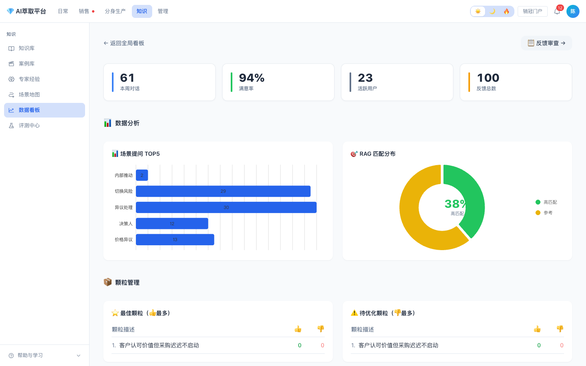
2. 点「补充颗粒」，填写场景标签、场景描述、专家思考、标准话术。
3. 保存后立即重建向量，缺口自动标记为已解决。

缺口只在检索全部找不到依据时记录；补录只是让内容参与检索，不保证每次都能命中。

## 09 知识库与案例库

1. 「知识库」放产品、价格、竞品、合规、术语等事实，可分企业私有/公共知识。
   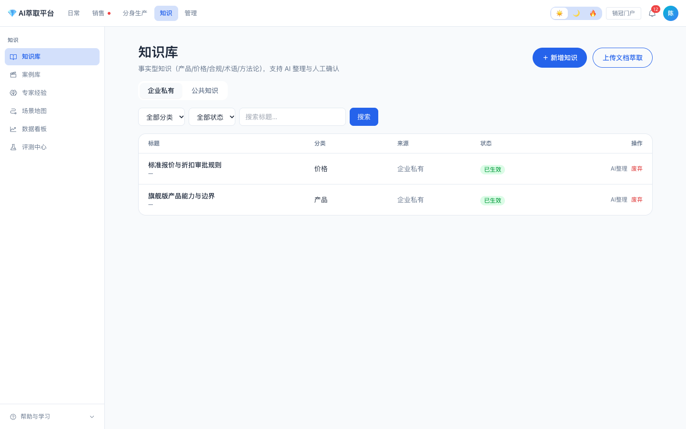
2. 「案例库」放客户画像、推进过程、结果、可复用点。
3. 新增可手工录入或上传文档萃取；萃取产出先待审核，通过后才参与回答。

## 10 创建用户与注册码

1. 企业管理员：进入「用户管理」→「创建用户」。
   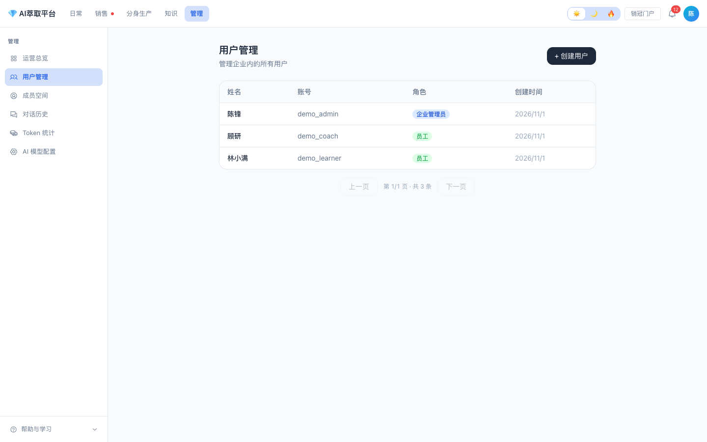
2. 平台超管：进入「企业合作」建企业，再生成注册码。
3. 员工也可以在企业注册页用注册码 + 姓名 + 账号 + 密码自助注册。

注册码创建时默认不设到期时间和使用次数上限；默认角色可选员工或企业管理员。

## 11 培训与认证

1. 进入「培训计划」，新建计划并发布版本。
   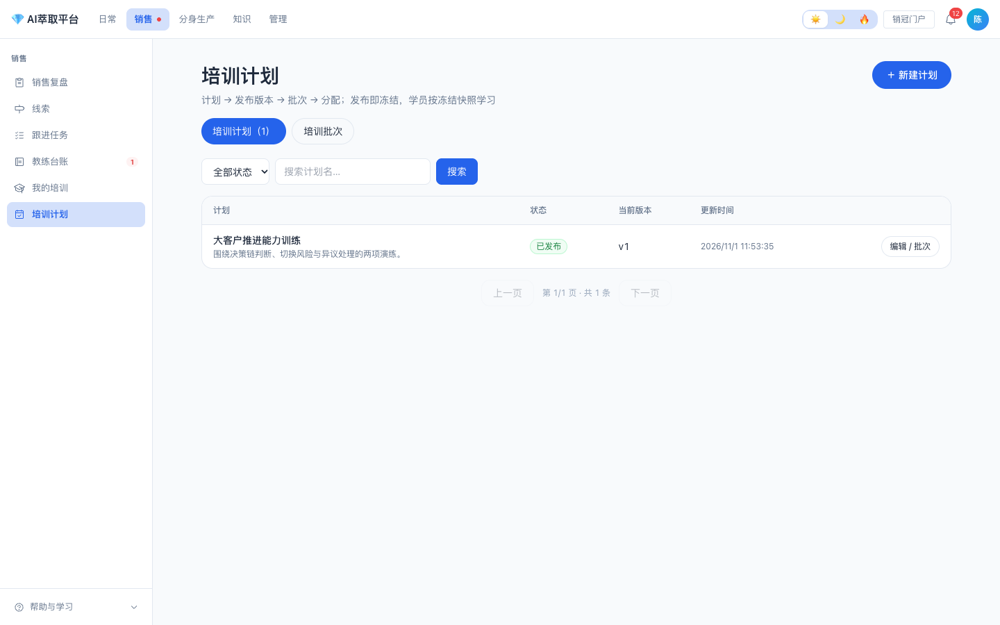
2. 创建批次并分配学员；批次只能绑定已发布的版本。
3. 学员在「我的培训」完成阅读/陪练/考试，管理员在批次详情做认证。

只有配置了前置任务的任务才会锁定；必修任务全部通过后进入认证。

## 12 分享与飞书

1. 在「分身管理」点「共享」，分别控制对内/对外分享。
   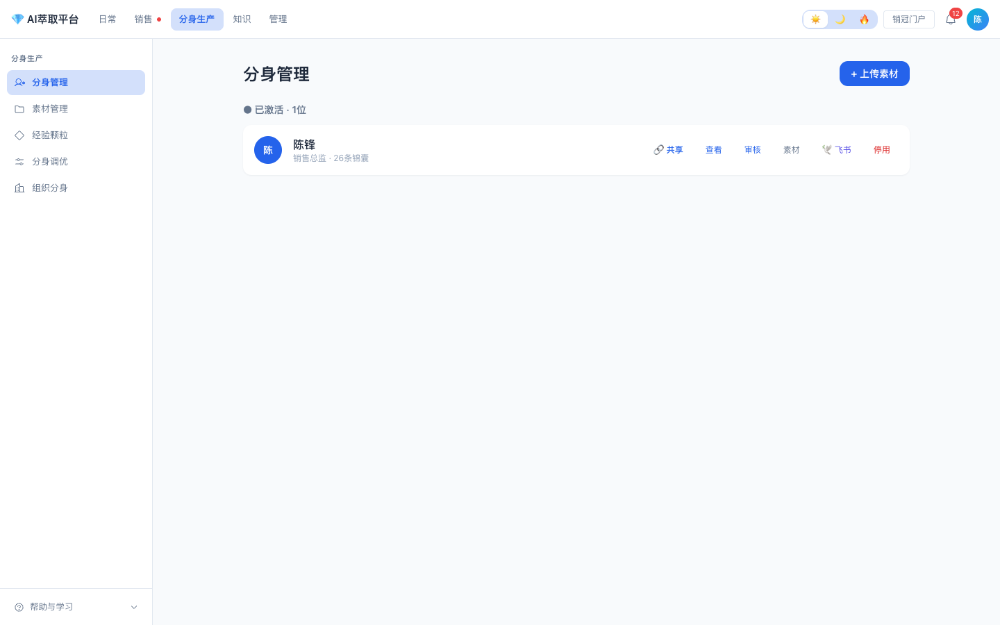
2. 在「分身生产 → IM 分身接入」发布到飞书，一个分身对应一个机器人。

企业微信、钉钉、微信当前没有可用的分身发布入口。
