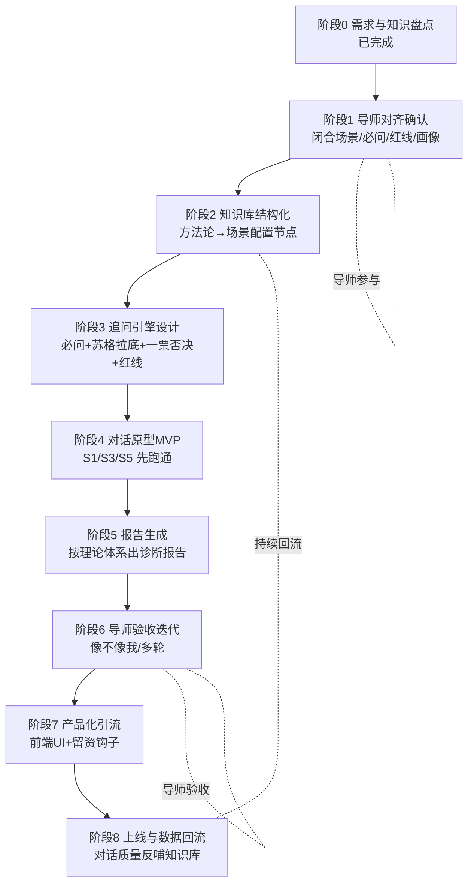

# 06_实施路线图 · 伟达商业咨询分身

> 本文档把"做一个前端引流型 AI 咨询分身"的需求，拆解成可执行的实施流程。
> 配套文档：01_产品需求理解 / 03_理论方法论分析 / 04_场景与方法论映射 / 05_场景与理论沟通。

## 一、需求清晰度评估

| 维度 | 状态 | 说明 |
| --- | --- | --- |
| 产品形态 | ✅ 清晰 | 选场景 → 苏格拉底式追问把问题问清 → 按导师理论体系出诊断报告 → 引流到真人咨询 |
| 知识来源 | ✅ 清晰 | 27 份导师方法论已转 md（原知识/md/），且"一物两用"：既生成必问问题、也作报告打分框架 |
| 场景清单 | ⚠️ 待确认 | 已有建议 S1–S10，需导师确认/收敛 |
| 每场景参数 | ⚠️ 待确认 | 必问问题、一票否决、追问边界、红线——需导师填 |
| AI 画像 | ⚠️ 待确认 | 最像"数字分身" / "诊断顾问" / "教练"？ |
| 问够了标准 | ⚠️ 待确认 | 进入"分析"的触发条件 |

**结论**：需求方向已清晰，但进入开发前必须先完成一次**导师对齐会**闭合上表 ⚠️ 项；之后可机械翻译落地。

## 二、总体流程图

## 三、分阶段实施步骤

### 阶段1 · 导师对齐确认（阻塞项，必须先做）
- **目标**：锁死所有 ⚠️ 配置参数。
- **步骤**：
  1. 给导师发《一页纸说明 + 场景清单 S1–S10》（模板见 05_场景与理论沟通），请他做判断题（对/错/补）。
  2. 开一次 20 分钟对齐会，按 05 文档的"5 问脚本"过核心场景。
  3. 回收每个场景的：必问问题清单、一票否决信息、追问允许范围、红线清单。
  4. 确认 AI 画像（建议锚定"数字分身"）与"问够了"的触发标准。
- **产出**：《场景×理论配置表（已确认版）》
- **参与方**：导师（验收）、你（技术/引导）
- **验收**：导师签字/确认，无未决 ⚠️ 项。

### 阶段2 · 知识库结构化
- **目标**：把导师方法论拆成机器可消费的场景配置。
- **步骤**：
  1. 按 04 文档的"知识库节点 Schema"，把每个场景写成一份配置文件（问题节点 / 规则节点 / 报告节点）。
  2. 问题节点：必问问题 + 追问分支 + 模糊时的澄清话术。
  3. 规则节点：一票否决闸门、苏格拉底追问触发条件、红线拦截。
  4. 报告节点：引用导师方法论的打分维度（如七步判生意法的 70 分表）。
- **产出**：结构化知识库（YAML/JSON 配置 + 对应 md 说明）
- **依赖**：阶段1 产出
- **验收**：每个场景配置可被引擎读取，无悬空引用。

### 阶段3 · 追问引擎设计
- **目标**：定义对话的"骨架逻辑"。
- **步骤**：
  1. 必问流程：线性必问 + 条件分支（一票否决未过不让结束）。
  2. 苏格拉底追问规则：模糊→具体、感受→事实、结果→原因、原因→证据、矛盾→指出、遗漏→补问。
  3. 红线拦截：不懂装懂 / 替客户猜数字 / 跳出领域 / 过早结论 / 无证据判断 一律拦截。
  4. 收口逻辑：满足"问够了"标准 → 转报告生成。
- **产出**：对话状态机 / 提示词工程规范
- **依赖**：阶段2
- **验收**：用脚本跑通一个场景的边界用例（含红线触发）。

### 阶段4 · 对话原型 MVP
- **目标**：先跑通 3 个场景验证"像不像"。
- **步骤**：
  1. 选 S1 创业可行性 / S3 增长瓶颈 / S5 团队管理（覆盖度最广）。
  2. 接大模型 + 阶段2 配置驱动，实现可对话原型。
  3. 实现基础前端：场景选择 → 对话 → 临时报告。
- **产出**：可运行对话原型（本地/网页）
- **依赖**：阶段2、3
- **验收**：3 个场景各能走完一轮完整咨询。

### 阶段5 · 报告生成
- **目标**：按导师理论体系输出诊断报告。
- **步骤**：
  1. 报告模板：问题复述 / 核心矛盾 / 根因 / 按方法论打分 / 下一步建议 / 引流钩子。
  2. 打分维度直接复用导师方法论里的评分表（如七步判生意法）。
  3. 引用导师原话/金句（金句库已转 md）增强"像导师"。
- **产出**：报告生成器
- **依赖**：阶段2
- **验收**：报告结构对齐导师真实诊断习惯（导师抽查）。

### 阶段6 · 导师验收迭代
- **目标**：逼近"这就是我"。
- **步骤**：
  1. 导师实测 3 个场景，打分"像不像我"。
  2. 针对不像的地方（提问语气/追问深度/判断偏差）回阶段2/3 调参。
  3. 迭代 2–3 轮直到导师认可。
- **产出**：验收通过的原型
- **参与方**：导师（验收）、你（调参）
- **验收**：导师主观认可 ≥ 预期。

### 阶段7 · 产品化引流
- **目标**：包装成前端引流产品。
- **步骤**：
  1. 场景选择页（知识边界可视化）+ 推荐问题。
  2. 对话 UI、报告页、留资/预约钩子（引到真人咨询）。
  3. 数据回流：对话质量 → 反哺知识库（阶段2）。
- **产出**：可上线产品
- **依赖**：阶段4–6
- **验收**：端到端跑通引流闭环。

### 阶段8 · 上线与运营
- **目标**：持续迭代。
- **步骤**：
  1. 灰度上线，监控对话完成率/报告采纳率。
  2. 用真实对话数据补全缺口场景（文档二的反向补全法）。
  3. 知识库持续扩展新场景。
- **产出**：运营中的产品 + 增长的知识库

## 四、关键风险与未决项

1. **导师参与成本**：用"我们翻译→导师验收"模式（05 文档），避免请导师设计产品。
2. **问答质量 = 报告质量**：必问问题未问清前，禁止进入报告（一票否决闸门）。
3. **苏格拉底 vs 效率**：追问过深会拖时长，需在阶段1 定"追问深度上限"。
4. **红线不可越**：阶段3 必须硬拦截，宁可说"这点我需要您补充"也不瞎编。

## 五、建议的第一步

立即做**阶段1**：把 05_场景与理论沟通.md 里的"一页纸 + 5 问脚本"发给导师，约一次对齐会。这是后续所有技术工作的前置闸门。
