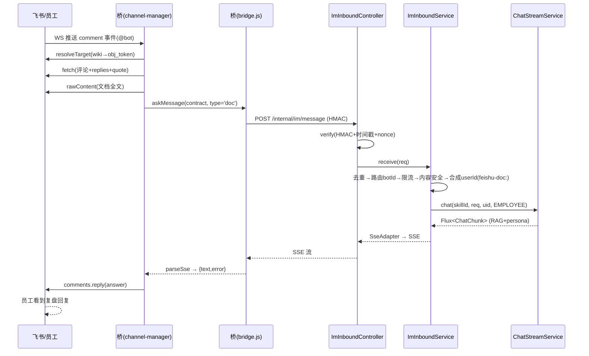

# 飞书文档评论（读文档 + 评论文档）— 代码级调用链与时序图

> 本文梳理「飞书机器人读取文档 / 评论文档」能力的完整代码级调用链与时序图。
> 覆盖三个落地场景：**销冠分身复盘**、**创始人分身评论**、**多 Agent 协同**。

---

## 一、概述

一个统一的「评论 @bot → 读文档 → 调分身 chat → 回复评论」链路，覆盖三个场景。
**差异只在「用哪个分身的人格 + 经验颗粒」，不在代码分支。**

| 场景 | 触发 | 分身产出 |
|---|---|---|
| 销冠分身复盘 | 销售把对话录写成文档 → @ 销冠 | 痛点问题 + 解决方案 |
| 创始人分身评论 | 员工写文档 → @ 创始人 | 老板视角点评 |
| 多 Agent 协同 | 一个文档 @ 多个 bot | 各分身各自处理、各自回复 |

---

## 二、完整代码级调用链

### ① 事件注册（桥启动时）

`feishu-bot/src/channel-manager.js:15` `connect()` 中注册：
```js
channel.on('comment', (evt) => this.handleComment(entry, evt));  // 第 31 行
```

### ② 评论事件入口

`feishu-bot/src/channel-manager.js:123` `handleComment(entry, evt)`
- `if (!evt.mentionedBot) return;` —— 未 @ 本 bot 直接忽略
- `entry.channel.comments.resolveTarget(fileToken, fileType)` —— wiki 节点转 obj_token
- `entry.channel.comments.fetch(target, commentId)` —— 拿评论 + replies + quote + isWhole

### ③ 读文档

`feishu-bot/src/channel-manager.js:166` `readDocument(entry, target)`
```js
entry.channel.rawClient.docx.document.rawContent({ path: { document_id: target.fileToken } })
// → resp.data.content，超 6000 字截断（DOC_MAX_CHARS）
```
> ⚠️ 命名空间是 `docx.document`（**没有 `v1`**），实测确认，不是 `docx.v1.document`。

### ④ 组装消息

`feishu-bot/src/channel-manager.js:249` `extractCommentText(comment)` —— 从 replies 取 `text_run.text`
`feishu-bot/src/channel-manager.js:262` `buildDocMessage(question, quote, docText)` —— 拼「用户评论 + 选中原文 + 文档内容」

### ⑤ 组装 contract 并发后端

`handleComment` 内构造 contract：
```js
{
  channelType: 'feishu',
  botId: entry.appId,
  messageId: 'doc:' + commentId,                     // 去重键
  conversation: { id: fileToken, type: 'doc' },      // CONV_DOC
  sender: { id: operator.openId },
  message: { type: 'text', text: full }
}
```
→ `feishu-bot/src/channel-manager.js:228` `askBackend(entry, contract)` → `bridge.askMessage(contract)`

### ⑥ 桥 → 后端 HTTP（HMAC）

`feishu-bot/src/bridge.js:15` `askMessage(contract)`
```js
axios.post(backendUrl + '/internal/im/message', body, { headers: signHeaders(secret, body) })
```
`feishu-bot/src/bridge.js:49` `parseSse(raw)` —— 聚合成 `{ text, error }`

### ⑦ 后端入站

`backend/.../controller/ImInboundController.java:60` `message()`
- 第 99 行 `verify()`：HMAC 验签 + 时间戳窗口 + **nonce 一次性（Redis SETNX）**
- `parse(body)` → `SseAdapter.fromFlux(imInboundService.receive(req))`

### ⑧ 后端路由

`backend/.../service/ImInboundService.java:58` `receive(req)`
1. 去重 `im:dedup:{botId}:{messageId}`（Redis SETNX，TTL 1h）
2. `findByBotId(botId)` → 绑定分身 → skillId
3. 限流（每 bot 每分钟，Redis INCR）
4. 非文本检查
5. `queryGate.auditSimple` 内容安全
6. 第 118 行 `resolveSyntheticUserId(req)` —— **doc 分支**：
   ```java
   key = SYNTHETIC_DOC_PREFIX + convId + ":" + senderId;  // feishu-doc:{fileToken}:{openId}
   ```
7. `chatStreamService.chat(skillId, chatReq, syntheticUserId, RolePermissions.EMPLOYEE)`

### ⑨ 分身 chat 管线（persona + RAG）

`ChatStreamService.chat()` → 检索该分身经验颗粒 → persona 生成 → `Flux<ChatChunk>`（SSE 流式）

### ⑩ 回复评论（桥 → 飞书）

SSE 流回桥 → `parseSse` 得 answer → `handleComment` 内：
```js
entry.channel.comments.reply(target, commentId, answer, { topLevel: comment.isWhole })
```

---

## 三、时序图

### ASCII 版（终端可读）

```
 员工/飞书              桥 (feishu-bot)                     后端 (Spring)                    分身 (ChatStreamService)
    │   channel-manager.js      bridge.js      ImInboundController  ImInboundService
    │        │                     │                  │                   │                │
    │  ①员工在文档 @bot 评论        │                  │                   │                │
    ├────────►│                     │                  │                   │                │
    │  WS推送 comment 事件           │                  │                   │                │
    │        │ ②handleComment(evt)  │                  │                   │                │
    │        │  mentionedBot?       │                  │                   │                │
    │        │  resolveTarget() ──► 飞书 comment API（wiki→obj_token）      │                │
    │        │  fetch(commentId) ──► 飞书（评论+replies+quote）              │                │
    │        │  readDocument() ────► rawClient.docx.rawContent（文档全文）   │                │
    │        │  extractCommentText + buildDocMessage                         │                │
    │        │ ③askBackend(contract)│                  │                   │                │
    │        │   ──────────────►askMessage()            │                   │                │
    │        │   ┌── POST /internal/im/message (HMAC 签名) ──────────────►  │                │
    │        │   │                             ④message() → verify(HMAC+时间戳+nonce)      │
    │        │   │                               → parse → SseAdapter.fromFlux(          │
    │        │   │                                        receive(req))  │                │
    │        │   │                                        │ ⑤receive:     │                │
    │        │   │                                        │  去重→路由→限流→内容安全→合成userId    │
    │        │   │                                        │ ──⑥chat(skillId, req, uid, EMPLOYEE)──►│
    │        │   │                                        │                   │  RAG检索颗粒+persona
    │        │   │                                        │                   │  ◄─ Flux<ChatChunk>
    │        │   │ ◄────────────── SSE 流 (text/event-stream) ────────────  │
    │        │   ◔ parseSse() → { text, error }           │                   │                │
    │        │  answer                                       │                   │                │
    │        │ ⑦comments.reply(target, commentId, answer) ──► 飞书评论回复                     │
    ├────────┤ ◄──────────────── 员工看到复盘的回复 ──────────────────────────────────────────  │
    │        │                     │                  │                   │                │
```

### Mermaid 版（粘到支持 mermaid 的地方渲染）



---

## 四、七个关键节点（对应图 ①~⑦）

| 节点 | 位置 | 动作 |
|---|---|---|
| ① | 飞书 → 桥 | WebSocket 推送 `comment` 事件（`@larksuite/channel` 长连接） |
| ② | channel-manager.js:123 | `handleComment`：resolveTarget → fetch → readDocument → 组装 |
| ③ | bridge.js:15 | `askMessage`：HMAC 签名 POST `/internal/im/message` |
| ④ | ImInboundController.java:60 | `message()`：verify（HMAC+时间戳+nonce）→ parse |
| ⑤ | ImInboundService.java:58 | `receive`：去重→路由→限流→内容安全→合成 userId |
| ⑥ | ChatStreamService.chat() | RAG 检索颗粒 + persona 生成 → `Flux<ChatChunk>` |
| ⑦ | channel-manager.js | `comments.reply` 把 answer 回复到飞书评论 |

---

## 五、关键设计点

1. **文档评论和多 Agent 共用一条链** —— 区别只在第 ⑧ 步 `findByBotId` 路由到的 `skillId` 不同（每个 bot 是独立应用、独立 `entry.appId`、独立 WebSocket 连接）。
2. **文档会话记忆** —— 第 ⑧ 步 `feishu-doc:{fileToken}:{openId}`，保证「同一文档 + 同一评论人」多轮复盘不串、有上下文。
3. **去重键** —— `doc:{commentId}`，同一评论事件只处理一次。
4. **内容安全 + 限流** —— 文档评论和普通聊天一样过 `queryGate` 和限流。
5. **文档长度** —— 超 `DOC_MAX_CHARS`(6000) 截断，避免撑爆 AI 上下文。
6. **非 doc/docx** —— `readDocument` 返回 null，回复「暂只支持文档」；sheet（表格）是另一套 range API，未接。

---

## 六、配置前提（每发布一个分身 bot，做一次）

**应用级（一次性）**
1. 「事件与回调」订阅 `drive.notice.comment_add_v1`（**长连接 WebSocket 模式**）
2. 权限管理开通：`docx:document:readonly`、`docs:document.comment:read`、`docs:document.comment:create`
3. 发布应用
4. ⚠️ 以应用身份接收事件，需「应用 + 用户」两个身份都开接收事件权限

**文档级（每篇文档一次）**
5. 文档「...」→「添加文档应用」→ 加该分身 bot 为协作者（可阅读）

---

## 七、涉及文件清单

| 文件 | 职责 |
|---|---|
| `feishu-bot/src/channel-manager.js` | comment 监听、读文档、组装、回复评论 |
| `feishu-bot/src/bridge.js` | 桥 → 后端 HTTP（HMAC）+ SSE 解析 |
| `feishu-bot/src/constants.js` | `CONV_DOC`、`DOC_MAX_CHARS` 常量 |
| `backend/.../common/ImConstants.java` | `CONV_DOC`、`SYNTHETIC_DOC_PREFIX` 常量 |
| `backend/.../controller/ImInboundController.java` | 入站接口 + HMAC/nonce 校验 |
| `backend/.../service/ImInboundService.java` | 去重/路由/限流/内容安全/合成 userId |
| `backend/.../service/ChatStreamService.java` | 分身 chat 管线（RAG + persona） |


后端的逻辑
后端这次接入飞书，从功能维度梳理如下（都是围绕「把分身发布成飞书机器人 + 员工在飞书里和分身对话/评论文档」这条主线）：

1. 生命周期管理（发布 / 下线 / 对账）— ImLifecycleService
功能	方法	说明
发起发布（扫码授权）	publish()	生成 registerToken 存 Redis(TTL 10min) → 调桥 /register 拿二维码
扫码完成绑定	completePublish()	落库 im_channel（1 分身 = 1 bot）+ 加密 appSecret → 调桥 /connect
下线机器人	unpublish()	置 disabled + 删凭据 → 调桥 /disconnect
开机对账	listActiveBots()	返回所有 published bot（含解密后 appSecret）供桥重建连接
机器人列表	listBots()	企业已发布机器人列表
凭据加解密	encryptSecrets/decryptAppSecret	appSecret 用 PartnerCrypto AES 加密落库，不存明文
2. 消息入站路由 — ImInboundService
receive() 一条链：去重 → 路由 → 限流 → 内容安全 → 合成 userId → 调 chat

去重：Redis im:dedup:{botId}:{messageId}（SETNX，TTL 1h，at-least-once）
路由：findByBotId(botId) → 绑定分身 skillId（外部只传 botId，无越权面）
限流：每 bot 每分钟 120 条（Redis INCR，fail-open）
内容安全：queryGate.auditSimple
合成 userId：单聊 feishu-user:{openId} / 群聊 feishu-chat:{chatId}:{msgId} / 文档 feishu-doc:{fileToken}:{openId}（本次新增）
调 chat：复用 chatStreamService.chat(skillId, req, uid, EMPLOYEE)
3. 内部接口 + 鉴权 — ImInboundController + ImBridgeAuth
接口	作用
POST /internal/im/message	消息入站 → SSE 流式回复
POST /internal/im/{channelType}/complete	扫码完成回调
GET /internal/im/{channelType}/active	开机对账拉 bot 列表
HMAC-SHA256 验签（timestamp\nnonce\nbody）
时间戳窗口（±300s）
nonce 一次性校验（Redis SETNX，本次新增的防重放）
4. 管理接口 — ImController
POST /im/channels/{channelType}/publish — 发布到飞书（仅企业管理员）
GET /im/channels/bots — 机器人列表
DELETE /im/channels/bots/{botId} — 下线
5. 数据模型 — V40__feishu_im_binding.sql
im_channel 加 bot_id（路由键）、skill_id（1:1 绑定）、status、secrets（加密凭据）
skill_conversation / skill_message 加 channel、external_user_id、external_user_name、external_chat_id（后台正确备注飞书用户）
6. 本次新增的「文档评论」支持
CONV_DOC 会话类型 + feishu-doc:{fileToken}:{openId} 合成 userId → 同一文档多人多轮复盘不串、有上下文
文档评论消息也走上面的「去重/路由/限流/内容安全」整条链
7. 权限 / 安全加固（本次 review 后补的）
SecurityConfig 放行 /internal/im/**（签名在 Controller 校验）
assertCompanyAdmin — 发布/下线仅企业管理员
resolveSkillCompany 从分身解析归属企业（不依赖 TokenContext，修了 super_admin 越权）
幂等守卫（completePublish 防重复绑定）、N+1 修复（loadSkillMap 批量查）
一句话：后端做了「发布/下线/对账」的生命周期管理 + 「去重/路由/限流/安全」的入站管线 + 一套 HMAC 鉴权的内部契约接口，把飞书消息和文档评论统一收编进现有的分身 chat 管线。